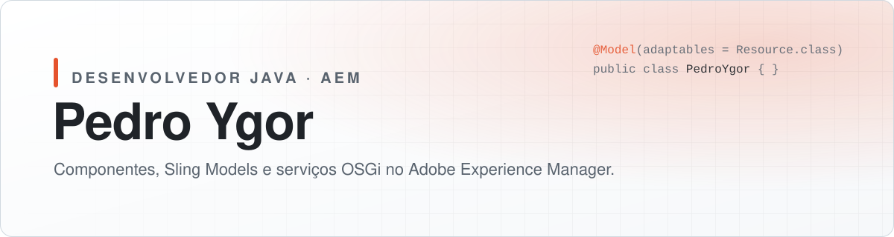
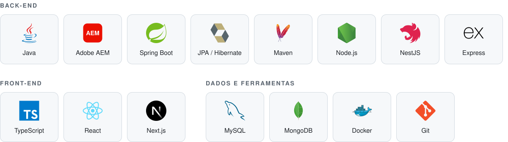
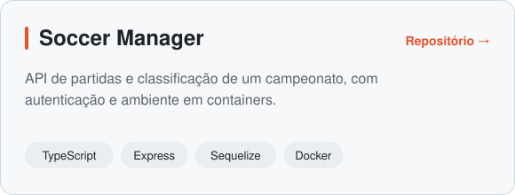
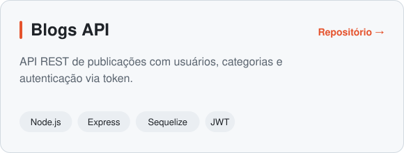
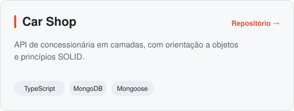
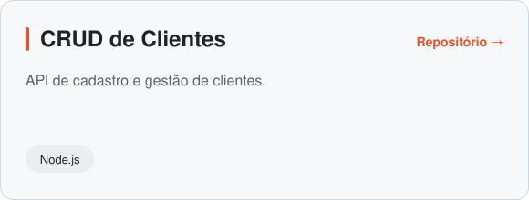
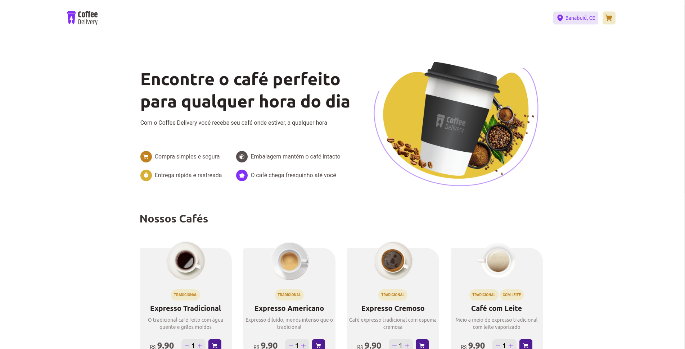
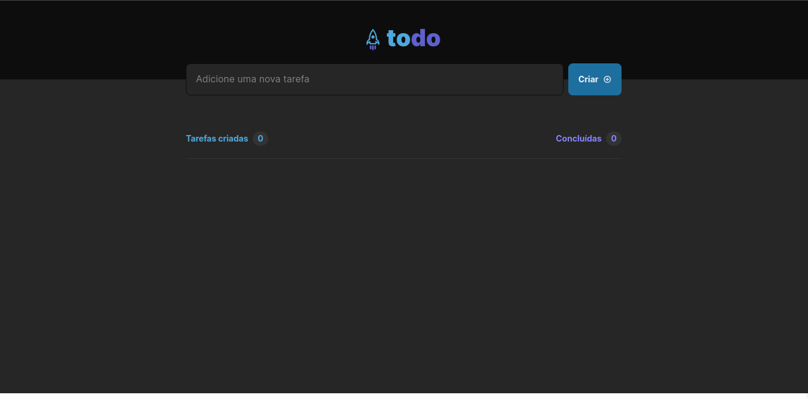

<picture>
  <source media="(prefers-color-scheme: dark)" srcset="./imgs/header-dark.svg">
  
</picture>

  <a href="https://pedroygor-portfolio.netlify.app/"><b>Portfólio</b></a>
  &nbsp;&nbsp;·&nbsp;&nbsp;
  <a href="https://www.linkedin.com/in/pedro-ygor/"><b>LinkedIn</b></a>
  &nbsp;&nbsp;·&nbsp;&nbsp;
  <a href="mailto:pedroygorlo888@gmail.com"><b>E-mail</b></a>

 

Sou desenvolvedor Java e trabalho com **Adobe Experience Manager**, construindo componentes, Sling Models e serviços OSGi. Antes do desenvolvimento, atuei com infraestrutura de TI e redes. Por isso, gosto de entender o sistema inteiro, do servidor à interface.

> **Agora:** Desenvolvedor Java Júnior na **Vasconcelos Solutions**, trabalhando com AEM. 
> **Estudando:** AEM as a Cloud Service, Spring Boot e testes automatizados.

 

## Formação

**Análise e Desenvolvimento de Sistemas** · Unicesumar 
**Desenvolvimento Web Full Stack** · Trybe

## Tecnologias

<picture>
  <source media="(prefers-color-scheme: dark)" srcset="./imgs/stack-dark.svg">
  
</picture>

  

## Projetos

<!--
Quando o projeto AEM estiver pronto, gere um card para ele no mesmo padrão e coloque-o aqui, antes dos demais.
-->

### Back-end

  <a href="https://github.com/pedroygor/trybe-futebol-clube">
    <picture>
      <source media="(prefers-color-scheme: dark)" srcset="./imgs/proj-soccer-dark.svg">
      
    </picture>
  </a>
  <a href="https://github.com/pedroygor/api-de-blogs">
    <picture>
      <source media="(prefers-color-scheme: dark)" srcset="./imgs/proj-blogs-dark.svg">
      
    </picture>
  </a>
  <a href="https://github.com/pedroygor/car-shop">
    <picture>
      <source media="(prefers-color-scheme: dark)" srcset="./imgs/proj-carshop-dark.svg">
      
    </picture>
  </a>
  <a href="https://github.com/pedroygor/backend-sharenergy">
    <picture>
      <source media="(prefers-color-scheme: dark)" srcset="./imgs/proj-clientes-dark.svg">
      
    </picture>
  </a>

### Front-end

<table>
  <tr>
    <td align="center" width="25%">
       
      <b>Coffee Delivery</b> 
      Loja de cafés com carrinho 
      React · TypeScript 
      <a href="https://pedroygor-coffee-delivery.netlify.app/">Demo</a> · <a href="https://github.com/pedroygor/coffee-delivery">Código</a>
    </td>
    <td align="center" width="25%">
       
      <b>Wallet</b> 
      Controle de gastos com conversão de moedas 
      React · Redux 
      <a href="https://pedroygor-trybe-wallet.netlify.app/">Demo</a> · <a href="https://github.com/pedroygor/trybe-wallet">Código</a>
    </td>
    <td align="center" width="25%">
       
      <b>Trivia</b> 
      Jogo de perguntas e respostas 
      React · Redux 
      <a href="https://pedroygor-trivia.netlify.app/">Demo</a> · <a href="https://github.com/pedroygor/trivia-project">Código</a>
    </td>
    <td align="center" width="25%">
       
      <b>Todo List</b> 
      Lista de tarefas 
      React · TypeScript 
      <a href="https://pedroygor-todo.netlify.app/">Demo</a> · <a href="https://github.com/pedroygor/desafio-01-ignite-todo-list">Código</a>
    </td>
  </tr>
</table>

 

